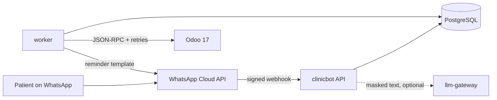

# WhatsApp booking for a clinic group: a forward-deployed case study

[](https://github.com/coldworld22/fde-case-study/actions/workflows/ci.yml)


A clinic group in Asir, Saudi Arabia, can't answer its phones in the morning rush. This repo is
the whole engagement: what I learned on site, what I built, how it was rolled out, and how it
was handed over. It's written the way I'd deliver it to a client.

> **Representative scenario.** The clinic, people and figures are a composite of the clients I
> work with (government and private sector in the Asir region, Odoo and WhatsApp integrations).
> The software is real, tested and runs locally in one command.

## The engagement in one page

| | |
|---|---|
| **Ask** | "Booking on WhatsApp, with AI." |
| **Real problem** ([discovery](docs/01-discovery.md)) | 35% of morning calls go unanswered while same-week slots sit empty. Patients already message the clinic on WhatsApp, in Arabic. Odoo is the system of record but goes offline weekly. |
| **What I built** | A WhatsApp bot that books, lists and cancels appointments in Arabic and English, routes patients to the right specialty, sends anyone describing an emergency to 997, syncs to Odoo even through outages, and reminds patients the day before. |
| **What I deliberately didn't build** | A free-chat AI agent ([ADR 1](docs/adr/0001-menus-over-free-chat.md)). Medical advice. Payments (phase 2). |
| **Rollout** ([plan](docs/03-rollout-plan.md)) | Staging role-play, one-branch pilot on two specialties, then all branches over six weeks, with a one-minute rollback. |
| **Handover** ([runbook](docs/04-handover-runbook.md)) | The clinic's IT contractor can run, monitor, change wording and recover failed syncs without me. |

## See it work

No WhatsApp account needed: `python -m clinicbot.simulate --demo` replays this conversation
against a real (in-memory) database. CI runs it on every push.

```text
👤 السلام عليكم
🤖 مرحباً بك في عيادات أبها الطبية 👋
   أرسل رقم الخدمة:
   1️⃣ حجز موعد
   2️⃣ مواعيدي
   3️⃣ إلغاء موعد

👤 1
🤖 صف لنا باختصار سبب الزيارة (مثال: ألم في الركبة، طفح جلدي، فحص حمل).

👤 ابني عنده حرارة وكحة من يومين            ← "my son has had a fever and cough for two days"
🤖 الأقرب في طب الأطفال:                     ← routed to Pediatrics
   1) الأحد 22 نوفمبر، 10:00 ص - أبها - المنسك (Dr. Faisal Al-Shehri)
   2) الأحد 22 نوفمبر، 10:30 ص - أبها - المنسك (Dr. Faisal Al-Shehri)
   3) الأحد 22 نوفمبر، 11:00 ص - أبها - المنسك (Dr. Faisal Al-Shehri)

👤 1
🤖 ما اسم المريض الكامل؟
👤 محمد أحمد العسيري
🤖 أرسل رقم الهوية الوطنية أو الإقامة للمريض (10 أرقام).
👤 1012345672                                 ← checked with the Luhn check digit
🤖 تأكيد الحجز: … أرسل نعم للتأكيد أو لا للإلغاء.
👤 نعم
🤖 ✅ تم الحجز. رقم الموعد AMC-L77RCQ.

👤 EN
👤 1
👤 I have chest pain and I'm short of breath
🤖 ⚠️ What you describe may be an emergency. Call 997 now or go to the nearest emergency
   department. Do not wait for a clinic appointment.
```

## How it's built



| Concern | How | Where |
|---|---|---|
| Arabic input | Normalises Arabic-Indic digits, hamza/ta marbuta/alef maqsura, diacritics; strips ال/و/ب prefixes for keyword matching | [`text.py`](src/clinicbot/text.py), [`triage.py`](src/clinicbot/triage.py) |
| Safety | Red-flag rules run first and can't be overridden; the LLM may only pick a specialty from a fixed list, with fallback on any error ([ADR 2](docs/adr/0002-rules-decide-emergencies.md)) | [`triage.py`](src/clinicbot/triage.py) |
| No double booking | One conditional `UPDATE … WHERE status = 'open'`; an 8-thread test proves one winner | [`scheduling.py`](src/clinicbot/scheduling.py) |
| Odoo outages | Transactional outbox, exponential backoff, idempotent delivery, no orphan events on early cancel ([ADR 3](docs/adr/0003-outbox-to-odoo.md)) | [`odoo.py`](src/clinicbot/odoo.py) |
| WhatsApp specifics | `X-Hub-Signature-256` check, fast `200` then background work, de-duplicated redeliveries, approved templates for reminders | [`whatsapp.py`](src/clinicbot/whatsapp.py), [`app.py`](src/clinicbot/app.py) |
| Privacy | IDs and phones masked before any LLM call; message text never stored or logged; `/ops/summary` is counts only | [solution design](docs/02-solution-design.md#security-and-privacy) |

59 tests cover the flow in both languages, triage (including tricky Arabic spellings and
false-positive traps like "kid" in "kidney"), the webhook end to end, the Odoo JSON-RPC client,
outbox retries and reminders. CI runs them on Python 3.11-3.13, again on PostgreSQL 16, and
smoke-tests the Docker image.

## Run it

```bash
pip install -e ".[dev]"
python -m clinicbot.simulate          # chat with the bot in your terminal
pytest -q                             # 59 tests

cp .env.example .env
docker compose up --build             # API on :8000, worker, PostgreSQL
docker compose run --rm seed          # demo branches and two weeks of slots
docker compose --profile odoo up      # optional: a real Odoo 17 on :8069 to sync into
```

To connect a real WhatsApp number, follow the [runbook](docs/04-handover-runbook.md#running-it).

## Documents

1. [Discovery](docs/01-discovery.md): observations, stakeholders, success metrics, scope
2. [Solution design](docs/02-solution-design.md): architecture, decisions, data, privacy, failure modes
3. [Rollout plan](docs/03-rollout-plan.md): pilot, training, rollback, risks
4. [Handover runbook](docs/04-handover-runbook.md): operating it without the developer
5. Decision records: [menus over free chat](docs/adr/0001-menus-over-free-chat.md) ·
   [rules decide emergencies](docs/adr/0002-rules-decide-emergencies.md) ·
   [outbox to Odoo](docs/adr/0003-outbox-to-odoo.md)

## Related

- [llm-gateway](https://github.com/coldworld22/llm-gateway): the OpenAI-compatible gateway used in `llm` triage mode
- [odoo-whatsapp-integration](https://github.com/coldworld22/odoo-whatsapp-integration): my published Odoo app for the WhatsApp Business API
- [saudi-validators](https://github.com/coldworld22/saudi-validators): National ID, IBAN and phone validation for Java services

## License

MIT
