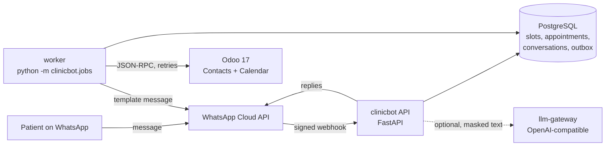

# 2. Solution design

## Architecture

Two processes from one image: the **API** answers WhatsApp in under a second; the **worker**
does everything that can wait or fail (Odoo sync, reminders).

## Request path

1. Meta posts the webhook. The API checks `X-Hub-Signature-256` against the app secret, returns
   `200` immediately, and processes the message in the background (Meta retries slow webhooks).
2. The message id is inserted into `processed_messages`; a duplicate delivery fails the primary
   key and is dropped. This makes retries harmless.
3. `BookingFlow` loads the patient's `Conversation` row, runs one state transition, saves it, and
   returns the replies. See the state diagram in [`conversation.py`](../src/clinicbot/conversation.py).
4. Replies are sent through the Cloud API.

## Key decisions

| Decision | Alternatives considered | Why | ADR |
|---|---|---|---|
| Numbered menus, free text only for the visit reason | Fully conversational LLM agent | Predictable, testable, works on any phone, no hallucinated bookings | [1](adr/0001-menus-over-free-chat.md) |
| Emergencies decided by rules; LLM may only pick a specialty | LLM decides everything | Safety must not depend on a model's mood or an outage | [2](adr/0002-rules-decide-emergencies.md) |
| Transactional outbox to Odoo | Call Odoo during the chat | Odoo's uplink drops weekly; patients must never wait on it | [3](adr/0003-outbox-to-odoo.md) |
| Conditional `UPDATE … WHERE status='open'` to book | Row locks, optimistic version column | One statement, same behaviour on SQLite and PostgreSQL, proven by an 8-thread test | - |
| National ID as the Odoo patient key | Phone number | Families share phones; reception already searches by ID | - |
| PostgreSQL in the client's Riyadh-region tenant | SaaS chatbot platform | Data residency, the client owns the data, no per-message platform fee | - |

## Data model

| Table | Purpose | Retention |
|---|---|---|
| `slots` | Bookable 30-minute slots per branch/specialty | Rolling, generated from Odoo working hours (phase 1: seeded) |
| `appointments` | Name, National ID, phone, slot, status | As the clinic's medical-records policy |
| `conversations` | Flow state per phone; reset after 30 minutes idle | Overwritten each chat |
| `processed_messages` | Webhook idempotency | 7 days |
| `outbox` | Pending Odoo changes with attempts and last error | 90 days |

No message text is stored. Visit reasons pass through triage and are discarded; only the chosen
specialty is kept.

## Security and privacy

- Webhook signature verified on every request; unsigned requests get `401`.
- Secrets only from environment variables; `.env` is git-ignored.
- LLM mode masks National IDs and phone numbers before any text leaves (`text.mask_pii`) and
  sends at most 500 characters. With `CLINICBOT_TRIAGE_MODE=rules` nothing leaves at all.
- Logs never contain message text or full phone numbers.
- `/ops/summary` exposes counts only.

## Failure modes

| Failure | What the patient sees | What happens |
|---|---|---|
| Odoo down | Nothing different | Outbox retries with backoff 1, 2, 4… 60 min; `failed` after 6 attempts |
| LLM down or slow (4 s timeout) | Nothing different | Keyword rules route instead |
| Two patients confirm the same slot | The second gets "someone just took that slot" plus new times | Conditional update lets exactly one win |
| Meta redelivers a webhook | Nothing | Duplicate message id ignored |
| Patient goes quiet mid-booking | Next message starts at the menu | 30-minute idle reset; nothing half-booked |
| Cancellation before Odoo ever heard of the booking | Nothing | Worker skips both events; no orphan calendar entry |
